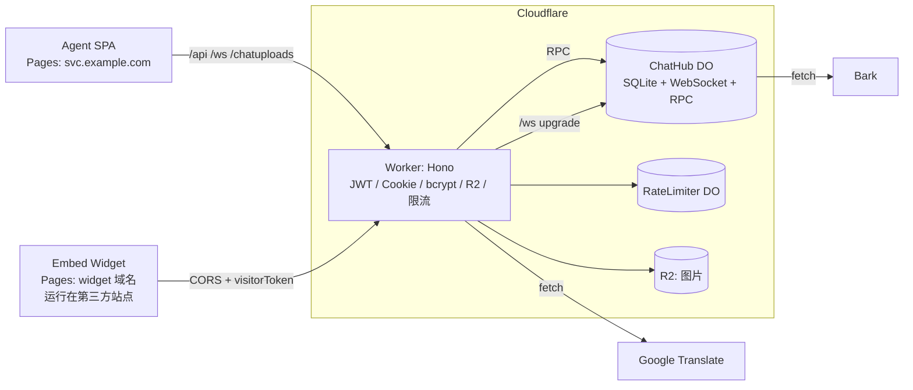

# Cloudflare 版本方案与实施记录 (Durable Object 内置 SQLite + R2 + Pages)

代码位置:`cfhost/`(自建版本原样保留在 `selfhost/`)。本文件同时是设计说明和落地状态记录。

## 1. 最终选型

| 目标 | 方案 | 说明 |
|---|---|---|
| 数据库 | **ChatHub Durable Object 内置 SQLite** (`ctx.storage.sql`) | 已放弃 D1。同步 API、与 DO 同机、无网络往返,写法最接近原 `better-sqlite3`;不需要 KV。 |
| 实时通信 | 原生 WebSocket + Hibernation API | Socket.IO 不能运行在 Workers/DO;事件名保持不变,前端用兼容封装 `rt-client.js`。 |
| 图片 | R2 | key 与原 `upload_files.filename` 一致(`YYYY/MM/xxx.ext`)。 |
| 前端 | Cloudflare Pages × 2 | `cfhost/client-agent`(Vite)、`cfhost/embed_widget`(静态脚本)。 |
| HTTP API | Worker + Hono | 无状态部分(JWT、Cookie、bcrypt、CORS、R2 读写、限流)在 Worker,数据读写通过 RPC 调 ChatHub。 |

### 为什么 DO SQLite 比 D1 更适合本项目

- 同步执行:没有 `await` 的处理逻辑天然原子。原方案里为 D1 设计的"按访客串行化 / 防重复建房 / 批量事务"都不再需要,"查最近房间 -> 没有则创建"、"保存消息并更新已读"在一个同步块内完成。
- 无网络往返:房间列表(带相关子查询)可直接沿用原 SQL,不必冗余 `lastMessage` 等字段。
- 计费方式与 D1 类似(按 rows read / written),额度够用。
- 代价:数据只能经过 ChatHub 访问,所有 API 的数据操作都要多一次 RPC;单对象存储上限(目前每个 SQLite 后端 DO 为 10 GB,请以官方文档为准)——聊天文本远低于此,图片在 R2。

## 2. 架构



- **ChatHub(单实例 `idFromName('main')`)**:唯一的有状态对象。持有 SQLite 数据库、全部 WebSocket,并以 RPC 方法向 Worker 提供数据操作。
- **Worker**:验证身份(agent JWT、访客签名 Cookie / JWT),把"身份结论"传给 ChatHub 做授权判断。bcrypt 在 Worker 中计算,避免占用 ChatHub 的单线程。
- **RateLimiter**:每个 `<bucket>:<ip>` 一个小 DO,固定窗口计数(登录 5 次 / 15 分钟,上传 20 次 / 15 分钟),取代 `express-rate-limit`(Workers 自带的限流绑定只支持 10s / 60s 窗口)。
- **R2**:图片;`/chatuploads/*` 授权通过后流式返回。

### 域名与路由

Agent 依赖 `httpOnly; Secure; SameSite=Lax` Cookie,因此 API 必须与 Agent 前端同站:

- `svc.example.com` -> Pages(client-agent)
- 同一 zone 上给 Worker 配置路由:`svc.example.com/api/*`、`svc.example.com/ws`、`svc.example.com/chatuploads/*`(见 `wrangler.jsonc` 注释)。前端因此继续使用 `window.location.origin`。
- 备选:Pages Functions + Service Binding 代理;或改用 "Workers + Static Assets" 单 Worker 方案。
- 嵌入脚本在第三方站点,Cookie 不可靠,依赖 `visitorToken`(`x-visitor-token` 头 / `?vt=`);Worker 对 `/api/*`、`/chatuploads/*` 反射 Origin 并允许凭据。`/ws` 不套 CORS(101 响应头不可改),身份校验在首条消息中完成。

## 3. 代码结构(已实现)

```
cfhost/
  worker/
    wrangler.jsonc          # R2 + 2 个 DO,无 D1/KV
    src/
      index.ts              # Hono 路由装配,/ws 转发给 ChatHub
      hub.ts                # ChatHub:WebSocket 事件 + RPC 数据接口
      db/schema.ts          # 版本化迁移(表 _schema),在 DO 构造时执行
      db/store.ts           # 所有 SQL(同步),含批量导入
      rate-limiter.ts
      routes/{auth,content,translate,upload,files,admin}.ts
      lib/{auth,jwt,cookies,access,push,util,names}.ts
    scripts/
      create-agent.mjs      # 通过 /api/admin/agents 创建客服账号
      import-selfhost.mjs   # 从自建版 chat.db + chatuploads 迁移
      smoke.mjs             # 端到端冒烟测试(对 wrangler dev)
  shared/rt-client.js       # WebSocket 客户端(socket.io API 兼容子集),唯一源码
  scripts/sync-rt-client.mjs# 生成 client-agent/src/rt-client.js 与 embed_widget/rt-client.js
  client-agent/             # Pages:socket.js 改用 rt-client;vite 代理;_redirects / _headers
  embed_widget/             # Pages:embed.js 改用 rt-client;build.mjs 产出 dist/
```

### ChatHub 对 Worker 暴露的 RPC

| 类别 | 方法 |
|---|---|
| 账号/会话 | `getAgentByUsername`、`getAgentById`、`createAgentSession`(同设备类型旧会话下线并推送 `force-logout`)、`verifyAgentSession`、`endSession`、`changeAgentPassword`(其它会话下线) |
| 访客 | `getVisitorRoomSummary` |
| 内容 | `getHistory`(Worker 传入"是否 agent / 已验证的 visitorId 列表",授权在 ChatHub 内判断)、`getKnowledge`、`replaceKnowledge` |
| 上传 | `authorizeUpload`(含访客无房间时原子建房)、`recordUpload`、`getFileAccess` |
| 运维 | `adminCreateAgent`、`adminImport`、`adminCounts`(经 `ADMIN_TOKEN` 保护) |

### WebSocket 协议

```
客户端 -> 服务端   {"e":"send-message","id":12,"d":{...}}   // 有 id 则期待 ack
服务端 -> 客户端   {"a":12,"d":{"success":true,...}}        // 替代 socket.io callback
服务端 -> 客户端   {"e":"new-message","d":{...}}
心跳:客户端发送文本 "ping",运行时自动回 "pong"(不唤醒休眠的 DO)
```

- 事件保持原名:`visitor-join`、`visitor-page-change`、`agent-login`、`join-room`、`leave-room`、`request-room-list`、`update-room-status`、`mark-read`、`send-message`;服务端事件 `version-check`、`joined`、`room-list`、`new-message`、`receive-message`、`new-visitor`、`force-logout`、`error`。
- socket 级状态(角色、agent/visitor 信息)存放在 `serializeAttachment`(≤2KB);Hibernation 唤醒后从中恢复。
- 注意:WebSocket tag 在 `acceptWebSocket` 之后不可更改,而角色在认证后才确定,因此不使用 tag,而是遍历 `ctx.getWebSockets()` 按 attachment 过滤(连接数为客服场景量级,开销可忽略)。
- 房间广播 = 全部 agent socket + 绑定到该房间的访客 socket。agent 不再逐房间 join,会收到所有房间的消息(客户端本来按 roomId 过滤)。
- 房间列表广播做了 50ms 合并;同一 agent 多个 socket 只计算一次。
- 未认证连接:连接后 10 秒内必须发 `agent-login` / `visitor-join`,否则由 alarm 以 4401 关闭(本地 `wrangler dev` 中关闭帧会再延迟约 10 秒到达客户端,服务端状态不受影响;生产环境表现需上线后确认)。
- 与自建版的有意差异:`agent-login` 现在**必须**带有效 session(原实现允许只带 JWT);图片文件类型以文件头魔数为准而不是客户端声明;`send-message` 的 `type` 只接受 `text` / `image`。

## 4. 数据库

- 表结构与自建版相同(agents / rooms / messages / room_reads / agent_sessions / upload_files / knowledge_entries),**去掉了 FOREIGN KEY**,由应用保证关系,批量导入因此不依赖插入顺序。
- 新增索引:`messages(roomId, timestamp)`、`rooms(visitorId, createdAt)`、`rooms(isActive, status, doneAt)` 等。
- 迁移机制:`db/schema.ts` 的 `MIGRATIONS` 数组只追加不修改;版本记录在 `_schema` 表,ChatHub 构造时在 `blockConcurrencyWhile` 内执行。
- 时间格式沿用现状(混用 `CURRENT_TIMESTAMP` 与 ISO 字符串),避免历史数据比较出错。
- DO 存储带有内置的时间点恢复(PITR)能力,可作为备份手段(具体保留期与用法见官方文档);另可用 `import-selfhost.mjs` 的逆向思路写导出脚本。

## 5. 本地开发

```bash
cd cfhost/worker
npm install
cp .dev.vars.example .dev.vars          # 填 JWT_SECRET / ADMIN_TOKEN 等
npm run dev                             # wrangler dev, http://127.0.0.1:8787
npm run agent:create -- alice secret123 Alice
npm run smoke                           # 端到端冒烟测试

cd ../client-agent && npm install && npm run dev   # :2083,/api /ws /chatuploads 代理到 8787
cd ../embed_widget && npm install && npm run build # 产出 dist/
```

已验证(见 `scripts/smoke.mjs`):登录 / 同设备互踢 / verify-token / 访客认证 / WebSocket 双端收发与 ack / 未读数 / 越权发送被拒 / 历史记录三种授权 / R2 上传、魔数校验、授权读取 / 图片消息校验 / 30 秒结束会话保护 / 知识库 / 未认证连接超时。另用合成的自建版 `chat.db` 验证了 `import-selfhost.mjs`(含图片、账号登录、历史、知识库)。

## 6. 部署清单

1. **资源**:`wrangler r2 bucket create chatboxy-uploads`。
2. **密钥**(`wrangler secret put`):`JWT_SECRET`(**必须与自建版相同**,现有 agent/visitor JWT 才继续有效)、`COOKIE_SECRET`(可选)、`GOOGLE_TRANSLATE_API_KEY`、`BARK_URLS`(逗号分隔)、`ADMIN_TOKEN`(迁移完成后可删除以关闭 `/api/admin/*`)。
3. **变量**:`wrangler.jsonc` 的 `APP_VERSION`(改动会让在线客户端刷新)、`APP_URL`(Bark 点击跳转)、可选 `HUB_LOCATION_HINT`(仅在 ChatHub 首次创建时生效,建议选靠近客服的区域)。
4. **路由**:取消 `routes` 注释并改成真实域名;`npm run deploy`。
5. **Pages**:
   - Agent:根目录 `cfhost/client-agent`,构建 `npm run build`,输出 `dist`;自定义域名 `svc.example.com`。
   - Embed:根目录 `cfhost/embed_widget`,构建 `npm run build`,输出 `dist`;把 `embed-settings.js` 里的 `apiUrl` 改成 API 域名。
6. **数据迁移**(可选,见第 7 节)。
7. **密钥轮换**:`selfhost/server/push-config.js` 中的 Bark URL 与 VAPID 私钥已提交在仓库历史里,上线后应轮换。

## 7. 从自建版迁移数据

```bash
ADMIN_TOKEN=... node scripts/import-selfhost.mjs \
  --db ../../selfhost/server/db/chat.db \
  --uploads ../../selfhost/chatuploads \
  --url https://svc.example.com
```

- 按 agents -> rooms -> messages -> room_reads -> agent_sessions -> upload_files -> knowledge_entries 分批(500 行)导入,并把 `chatuploads/` 下的图片按相同相对路径写入 R2;可重复执行(按主键 upsert / 覆盖)。
- 导入 `agent_sessions` 后客服无需重新登录;旧的 `visitorAuth` 签名 Cookie 格式与 `cookie-parser` 不同会失效,访客下次 `/api/visitor-auth` 自动重新下发,token 链路不受影响。
- 导入完成后脚本会打印目标端各表行数,与源库对照即可。
- 切换时建议在低峰期进行:先导入,再切路由/DNS,旧服务只读保留 1~2 周以便回滚;切换窗口内两边的新消息不会自动合并,需要停写后再做一次增量导入。

## 8. 被 Cloudflare 能力取代的部分

| 自建版 | Cloudflare 版 |
|---|---|
| Nginx、`nginx-security.conf`、SSL 证书 | 删除;安全头在 Pages `_headers`;TLS 由 Cloudflare 提供 |
| ModSecurity(`modsec_cus_rules.conf`) | Cloudflare WAF 托管规则 + 自定义规则 |
| pm2 / `restart_all.sh` / `deploy-security-fixes.sh` | `wrangler deploy` + Pages Git 集成;`APP_VERSION` 改为配置项 |
| `sync_embed_files.sh` | `embed_widget/build.mjs` + Pages 部署 |
| `express-rate-limit` | `RateLimiter` DO(可再叠加 WAF 速率规则) |
| 本地磁盘 `chatuploads/` | R2 |

## 9. 已知限制与后续事项

- **单 ChatHub 实例**:所有连接与数据汇聚一处(单线程),客服场景足够;需要横向扩展时再按 roomId 分片,代价是 agent 要连多个对象,暂不建议。
- **bcrypt 在 Worker 中计算**:每次登录约几十到上百毫秒 CPU;可选后续升级为 WebCrypto PBKDF2(Workers 上迭代数上限 100000)。
- **Hono Cookie 上限**:`Max-Age` 最大 400 天(浏览器本身也会截断),因此"永久登录"为 400 天,到期需重新登录(原为 10 年)。
- **客户端 IP**:统一取 `CF-Connecting-IP`。
- **embed 的 `index.html` 演示页、`EMBED_USAGE.md`** 未迁入 cfhost,按需补充。
- 前端 `rt-client.js` 与 Hibernation 的组合建议在预发布环境做一次空闲唤醒测试(空闲数分钟后发消息,确认 ack 正常)——本地 `wrangler dev` 不模拟真实休眠。

## 10. 已部署状态 (2026-10-20)

| 组件 | 名称 / 地址 |
|---|---|
| Worker + ChatHub / RateLimiter | `chatboxy-api`,路由 `csa.efxopen.com/api/*`、`/ws`、`/chatuploads/*` |
| R2 | 桶 `chatfile`(绑定名 `UPLOADS`) |
| Agent 前端 (Pages) | 项目 `chatboxy-agent`,自定义域名 `https://csa.efxopen.com` |
| Embed 脚本 (Pages) | 项目 `chatboxy-embed`,`https://chatboxy-embed.pages.dev`(`emloader.js` / `embed.min.js`;`embed-settings.js` 的 `apiUrl` = `https://csa.efxopen.com`) |
| 密钥 | `JWT_SECRET`(新生成,旧版签发的登录态失效)、`BARK_URLS`(取自旧 `push-config.js`);`ADMIN_TOKEN` 已在导入后删除 |
| 已导入数据 | `chat.db.backup.sqlite3`:agents 5、rooms 441、messages 4998、room_reads 2574、agent_sessions 7、upload_files 294、knowledge_entries 48 |

待办 / 注意:
- **图片文件尚未迁移**:`upload_files` 有 294 条记录,但源码目录里没有 `chatuploads/`,历史图片消息暂时无法显示。拿到目录后:临时在 `wrangler.jsonc` 设 `workers_dev: true`、`wrangler secret put ADMIN_TOKEN`、重新部署,再运行 `import-selfhost.mjs --skip-db --uploads <目录> --url https://chatboxy-api.axcf.workers.dev`,完成后恢复配置并删除密钥。
- `efxopen.com` 区域对非浏览器客户端(curl / node)返回 Cloudflare challenge,浏览器不受影响;因此运维脚本走 workers.dev。
- 未配置 `GOOGLE_TRANSLATE_API_KEY`(旧 `.env` 不在仓库中),翻译功能暂不可用:`wrangler secret put GOOGLE_TRANSLATE_API_KEY`。
- 新版 wrangler 的 `pages project create` 会委托给 Workers,需加 `--force` 且在 Pages 项目目录内执行(创建后无需再加)。

## 11. 嵌入网站授权(ALLOWED_ORIGINS)

只有授权的网站才能使用聊天插件,取代自建版"每个站点反代 `/api`"的做法(跨域 + 来源校验即可,无需反代,也不依赖隐藏后端地址)。

- 配置:`wrangler.jsonc` 的 `vars.ALLOWED_ORIGINS`,逗号分隔。写法:`https://www.example.com`(精确)、`https://*.example.com`(仅子域名,裸域名要另写一条)、`example.com`(只匹配主机,不限协议)。留空 = 不限制(本地开发用,`.dev.vars` 里已置空)。当前线上值为 `https://efxopen.com,https://*.efxopen.com`,**接入新站点时在这里追加并重新部署**。
- 生效位置:CORS 响应头(未授权来源拿不到 `Access-Control-Allow-Origin`,浏览器会拦截)、`POST /api/visitor-auth`、`POST /api/upload`(未授权来源 403)、`/ws` 升级(未授权 403)。Worker 自身域名(Agent 前端)始终放行。访客拿不到 token,就无法加入会话、发消息或读历史。
- 原理与边界:`Origin` 由浏览器设置且页面脚本无法伪造,所以能阻止"复制 JS 到未授权网站"。它不能防住脱离浏览器、手工伪造 `Origin` 的脚本;这类滥用靠 Cloudflare Bot 防护 / WAF 速率规则 / Turnstile 兜底。
- 验证:`scripts/origin-check.mjs`(本地,带 `--var "ALLOWED_ORIGINS:..."` 启动 `wrangler dev`);线上已验证 `chatboxy-embed.pages.dev` 来源被拒(CORS 拦截 + WebSocket 403),`csa.efxopen.com` 自身来源通过。
